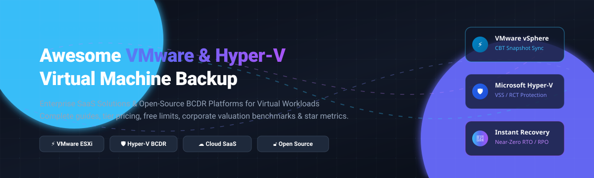

# 🛡️ Awesome Virtual Machine (VMware / Hyper-V) Backup & Disaster Recovery 🚀

A comprehensive, SEO-optimized, and curated guide to top **Virtual Machine (VM) Backup**, **Disaster Recovery (BCDR)**, and snapshot protection solutions for **VMware vSphere / ESXi** and **Microsoft Hyper-V** environments. Includes SaaS enterprise platforms, entry pricing tiers, exact free tier / trial terms, corporate valuations, and top open-source projects ranked by GitHub_Stars.

🌟 **Star this repository if you find it helpful for architecting your virtualization backup strategy!** 🌟

---

## 📑 Table of Contents

- [🌐 Sector Overview & Market Dynamics](#-sector-overview--market-dynamics)
- [🏢 SaaS & Commercial Enterprise Backup Platforms](#-saas--commercial-enterprise-backup-platforms)
- [🔓 Open-Source Virtual Machine Backup Software](#-open-source-virtual-machine-backup-software)
- [⚖️ Feature Matrix & Architecture Comparison](#️-feature-matrix--architecture-comparison)
- [🔍 Key Evaluation Criteria for VM Backup](#-key-evaluation-criteria-for-vm-backup)
- [🤝 Contributing](#-contributing)
- [💖 Support & Sponsorship](#-support--sponsorship)
- [📈 Star History](#-star-history)
- [📄 License](#-license)

---

## 🌐 Sector Overview & Market Dynamics

The global **Virtual Machine Backup and Recovery market** is currently valued between **$4.1 billion and $4.8 billion**, on a trajectory to expand to **$8.6 billion – $14.0 billion by the mid-2030s** at a compound annual growth rate (**CAGR of ~10.1% to 13.1%**). The broader **Disaster Recovery as a Service (DRaaS)** and cloud replication market exceeds **$14 billion to $23 billion**, propelled by an aggressive **16%–22% CAGR** driven by stringent data compliance (e.g., DORA, NIS2, GDPR) and the continuous threat of ransomware against virtualized hypervisors.

From a market concentration standpoint, the sector is **moderately fragmented yet increasingly oligopolistic at the high end**:
- **Market Structure:** While the hypervisor backup sector has historically accommodated dozens of specialized vendors, the enterprise tier is dominated by a tight cluster of multi-billion-dollar titans (**Veeam**, **Rubrik**, **Cohesity**, and **Commvault**), which together capture a significant share of Global 2000 backup spends.
- **Dynamics:** The market is not strictly "winner-take-all" due to hypervisor diversification and distinct segments (e.g., MSP-oriented vendors like **Datto/Kaseya**, budget SMB tools like **NAKIVO** and **Hornetsecurity/Altaro**, and sovereign on-prem open-source stacks). However, massive consolidations (such as Cohesity acquiring Veritas's data protection unit, Kaseya acquiring Datto, and Broadcom's VMware licensing shake-ups) continue to accelerate enterprise centralization toward end-to-end cyber resilience and zero-trust data platforms.

---

## 🏢 SaaS & Commercial Enterprise Backup Platforms

Below is the definitive index of SaaS, hybrid cloud, and hosted commercial Virtual Machine Backup platforms for VMware and Hyper-V. The table is **sorted in descending order by company valuation / scale** to reflect market presence and enterprise backing.

| 🏢 Platform | 💰 Company Valuation / ARR | 💵 Starting Tier Pricing | 🎁 Free Tier / Trial Terms | 🎯 Key Architecture & Highlights |
| :--- | :--- | :--- | :--- | :--- |
| [**Veeam Backup & Replication**](https://www.veeam.com/) | **~$15.0B Valuation** *(~$2.0B+ ARR)* | **~$95 – $230** /workload/yr *(Data Platform Essentials, via VUL subscription)* | **Permanent Free Community Edition:** Protects up to **10 workloads** (VMs, cloud, or physical) forever with no expiration. | Industry standard for VMware & Hyper-V. CBT integration, Instant VM Recovery from backup storage, CDP, and automated SureBackup recovery verification. |
| [**Rubrik Security Cloud**](https://www.rubrik.com/) | **~$11.0B – $15.0B MCap** *(~$1.66B Subscription ARR)* | **~£120 (~$150)** /TB/month list *(Typically 3-year commitment, ~$50k/yr starting tier)* | **POC / Demo upon request:** SaaS add-ons have trials (e.g., M365 trial capped at 500 users / 10 TB data for 30 days; Google Workspace at 10 users / 500 GB). | Zero-trust data security platform with immutable append-only file systems, near-zero RTO instant recovery, and automated ransomware blast-radius blast detection. |
| [**Cohesity DataProtect**](https://www.cohesity.com/) | **~$7.0B – $8.0B Valuation** *(~$1.7B+ ARR pro forma)* | **~$150 – $400** /FETB/yr *(Software-only) or ~$200–$500/TB/yr (SaaS DPaaS)* | **30-Day Free Trial:** Full enterprise cloud feature access provided via structured sales-engineered proof-of-concept. | Hyperconverged web-scale architecture for VMware & Hyper-V. AI-driven threat defense, global deduplication, and automated disaster recovery orchestration. |
| [**Commvault Cloud (VM Backup)**](https://www.commvault.com/) | **~$6.5B – $7.0B MCap** *(~$1.25B TTM Revenue)* | **~$10.25** /VM/month *(Sold as 10-VM pack at $102.49/mo) or ~$98/VM/yr* | **30-Day Free Trial:** Full SaaS access to Commvault Cloud VM backup, requiring no upfront credit card. | Enterprise-wide multi-cloud and hypervisor protection. Application-consistent CBT backups, automated air-gapping, and granular recovery. |
| [**Datto SIRIS (Kaseya)**](https://www.datto.com/) | **~$6.2B Valuation** *(Kaseya acquisition price)* | **~$200 – $500** /month service fee *(Often $0 upfront appliance fee on 36-mo contracts)* | **Custom POC / Demo:** Handled as a guided hardware trial and partner evaluation through MSP network. | Purpose-built BCDR appliance with local snapshot virtualization and hybrid cloud replication for instant failover of Hyper-V and VMware workloads. |
| [**Acronis Cyber Protect**](https://www.acronis.com/) | **~$3.5B Valuation** *(~$450M–$550M ARR)* | **~$10.00 – $20.00** /VM/month *(Via Cloud MSP tier) or ~$99/yr per host VM bundle* | **30-Day Free Trial:** Unlimited feature access including cloud backup storage quotas. | Unified cybersecurity, anti-malware, and VM backup. Supports cross-hypervisor P2V/V2V conversion and migration between VMware and Hyper-V. |
| [**Druva Data Resiliency Cloud**](https://www.druva.com/) | **~$2.0B Valuation** *(~$200M+ SaaS ARR)* | **~$210 – $300** /TB/month *(Consumption credit model on deduplicated data)* | **30-Day Free Trial:** Self-service registration with active workload connectors and cloud testing. | 100% agentless cloud SaaS backup for VMware and Hyper-V. Uses CBT, CloudCache local LAN appliances, and direct TurboTier instant restores. |
| [**Quest vRanger**](https://www.quest.com/products/vranger/) | **Multi-Billion PE Portfolio** *(Private, Quest Software)* | **~$300 – $450** /CPU socket *(Perpetual license starting point with basic maintenance)* | **30-Day Free Trial:** Fully functional trial licensed for up to **30 CPU sockets** (VM backup & replication) + 10 physical servers. | High-speed, agentless backup and replication for VMware ESXi and Hyper-V environments with differential change tracking and rapid restores. |
| [**NAKIVO Backup & Replication**](https://www.nakivo.com/) | **Profitable Mid-Market** *(Private SMB / Enterprise)* | **$1.95 – $2.45** /workload/month *(Or $229/CPU socket perpetual for Pro Essentials)* | **Permanent Free Edition:** Up to **10 workloads** + 5 M365 users forever (or 15-day unrestricted full-feature trial). | High-performance image-based VM backups with CBT/RCT, immutable backup repositories, deduplication, and cross-platform recovery. |
| [**Altaro VM Backup (Hornetsecurity)**](https://www.hornetsecurity.com/altaro-vm-backup/) | **Private PE Portfolio** *(Hornetsecurity Group)* | **~$595** /host *(Standard perpetual, up to 5 VMs) or ~$875/host (Unlimited Plus)* | **Permanent Free Edition:** Up to **2 VMs per host forever** (automatically active after the 30-day trial of Unlimited Plus). | Streamlined, user-friendly backup solution purpose-built for Hyper-V and VMware vSphere in SMB environments with augmented WAN replication. |

---

## 🔓 Open-Source Virtual Machine Backup Software

The open-source ecosystem for native VMware and Hyper-V hypervisor snapshotting requires robust change-block APIs (VADP/CBT and RCT). Below are the top open-source virtual machine backup tools and disaster recovery engines, **ranked in descending order by GitHub_Stars ⭐**.

*Note: The Stars_Badges link directly to each project's stargazers community page.*

### 1. [bup](https://github.com/bup/bup) 
* **GitHub Repository:** [`bup/bup`](https://github.com/bup/bup)
* **Stack:** Python, C, Bash | **License:** GPL-2.0
* **Architecture:** Highly efficient backup system based on the Git packfile format. It is designed to handle multi-terabyte virtual machine disk image files (`.vmdk`, `.vhdx`) through rolling-checksum chunking and fine-grained sub-file deduplication.
* **Why It Stands Out:** Unrivaled deduplication efficiency for raw VM disk images, making it an excellent storage engine for self-hosted VM backup targets.

### 2. [Bareos](https://github.com/bareos/bareos) 
* **GitHub Repository:** [`bareos/bareos`](https://github.com/bareos/bareos)
* **Stack:** C++, Python, Shell | **License:** AGPL-3.0
* **Architecture:** Comprehensive, enterprise-grade open-source backup suite with **native dual-hypervisor plugins**:
  - **VMware Plugin:** Leverages VMware vStorage APIs for Data Protection (VADP) and Changed Block Tracking (CBT) for agentless live snapshots without shutting down guests.
  - **Hyper-V Plugin:** Native Microsoft Hyper-V integration supporting Resilient Change Tracking (RCT) for incremental differential disk snapshots.
* **Why It Stands Out:** The only 100% open-source software offering production-ready native agentless CBT plugins for both VMware and Hyper-V with tape, S3, and disk backends.

### 3. [Proxmox Backup Server (Client / Engine)](https://github.com/proxmox/proxmox-backup) 
* **GitHub Repository:** [`proxmox/proxmox-backup`](https://github.com/proxmox/proxmox-backup)
* **Stack:** Rust, C, JavaScript | **License:** AGPL-3.0
* **Architecture:** Enterprise backup solution featuring client-side encryption, Zstandard compression, and chunk-based content-defined deduplication.
* **Hypervisor Integration Note:** While engineered natively for Proxmox VE, its standalone client allows backing up disk partitions and directories of host VMs running under VMware or Hyper-V at high speeds, though agentless CBT hypervisor snapshots are not supported out of the box.

### 4. [Hyper-V Backup Utility](https://github.com/Digressive/HyperV-Backup-Utility) 
* **GitHub Repository:** [`Digressive/HyperV-Backup-Utility`](https://github.com/Digressive/HyperV-Backup-Utility)
* **Stack:** PowerShell | **License:** MIT
* **Architecture:** Standalone, automated utility for Microsoft Hyper-V that automates VM export, live volume shadow copy snapshots, multi-threaded compression, retention rotations, and network share archival.
* **Why It Stands Out:** Zero-dependency, lightweight, native PowerShell tool designed for small-to-medium clusters needing reliable scheduled VM exports without agent bloat.

### 5. [Backupzit](https://github.com/Max-Zit/backupzit) 
* **GitHub Repository:** [`Max-Zit/backupzit`](https://github.com/Max-Zit/backupzit)
* **Stack:** Go, C#, Shell | **License:** GPL-3.0
* **Architecture:** Self-hosted unified backup manager developed as an open-source alternative to Veeam and NAKIVO. Directly interfaces with **VMware ESXi** and **Microsoft Hyper-V** VMs (including failover clusters).
* **Why It Stands Out:** Features deduplication, client-side encryption, immutable storage support, and bare-metal disaster recovery in a single package.

### 6. [Alike Backup](https://github.com/quadricsoftware/alike) 
* **GitHub Repository:** [`quadricsoftware/alike`](https://github.com/quadricsoftware/alike)
* **Stack:** Java, C++, PowerShell | **License:** GPL-2.0
* **Architecture:** Pioneer BDR engine supporting multi-hypervisor backup, file recovery, and instant disaster recovery replication across Hyper-V, XenServer, and XCP-ng environments.
* **Why It Stands Out:** Offers deduplicated global block storage and replication runbooks for heterogeneous virtualization topologies.

### 7. [XSIBackup (Community)](https://github.com/mjbeverley/xsibackup) 
* **GitHub Repository:** [`mjbeverley/xsibackup`](https://github.com/mjbeverley/xsibackup)
* **Stack:** Shell, C | **License:** Open-source / Dual licensed
* **Architecture:** Runs directly inside the VMware ESXi hypervisor console (ESXi 5.x/6.x/7.x), orchestrating hot snapshots and differential multi-threaded disk migration across local datastores and remote IP networks.
* **Why It Stands Out:** Requires zero external helper VMs or dedicated backup servers; executes natively within the ESXi OS.

### 8. [HyperVBackup PowerShell Module](https://github.com/hjorslev/HyperVBackup) 
* **GitHub Repository:** [`hjorslev/HyperVBackup`](https://github.com/hjorslev/HyperVBackup)
* **Stack:** PowerShell | **License:** MIT
* **Architecture:** Native PowerShell module wrapping Hyper-V WMI / VSS APIs to export live virtual machines with custom naming patterns, parallel transfers, and email reporting.
* **Why It Stands Out:** Simple CLI integration for SysAdmins building custom Windows Task Scheduler backup workflows.

### 9. [vmware-s3-backup](https://github.com/legitYosal/vmware-s3-backup) 
* **GitHub Repository:** [`legitYosal/vmware-s3-backup`](https://github.com/legitYosal/vmware-s3-backup)
* **Stack:** Python, pyVmomi | **License:** MIT
* **Architecture:** Connects to VMware vSphere/vCenter via pyVmomi, taking point-in-time snapshots of virtual machines and incrementally synchronizing virtual disk slices directly into AWS S3 or MinIO buckets.
* **Why It Stands Out:** Ultra-lightweight cloud-native pipeline for pushing ESXi virtual disk snapshots to object storage without proprietary appliances.

### 10. [DaliBackup-OSS](https://github.com/daliranas/DaliBackup-OSS) 
* **GitHub Repository:** [`daliranas/DaliBackup-OSS`](https://github.com/daliranas/DaliBackup-OSS)
* **Stack:** Node.js, SQLite | **License:** MIT / Open Source
* **Architecture:** Modern web-managed backup engine designed for Microsoft Hyper-V and Proxmox VE. Leverages VSS application-consistent checkpoints with streaming GZip compression and AES-256-GCM encryption.
* **Why It Stands Out:** Quick Docker deployment or single-binary Windows service with modern responsive dashboard.

---

## ⚖️ Feature Matrix & Architecture Comparison

| 🛠️ Platform | 🏷️ License Model | ⚡ VMware CBT | 🛡️ Hyper-V RCT | 🔄 Instant Boot / Recovery | 📦 Storage Target Flexibility | 🎯 Recommended Use-Case |
| :--- | :--- | :---: | :---: | :---: | :--- | :--- |
| **Veeam** | Commercial / Freemium | ✅ | ✅ | ✅ *(vPower)* | Cloud, Object, Tape, DAS, SAN | Industry standard, enterprise verified |
| **Rubrik** | Commercial SaaS | ✅ | ✅ | ✅ *(Live Mount)* | Managed Immutable Cloud / Appliance | Zero-trust cyber resilience & ransomware defense |
| **Cohesity** | Commercial SaaS/Appliance | ✅ | ✅ | ✅ *(Instant VM)* | Scale-out Cluster & Cloud Tier | Large enterprise multi-petabyte consolidation |
| **Commvault** | Commercial SaaS/Software | ✅ | ✅ | ✅ *(Live Recovery)* | Any Cloud, S3, Tape, Disk | Broad heterogeneous legacy + modern clouds |
| **Datto SIRIS** | Commercial Managed (MSP) | ✅ | ✅ | ✅ *(Local & Cloud)* | Datto BCDR Appliance + Cloud | Turnkey business continuity for MSPs |
| **Acronis** | Commercial SaaS | ✅ | ✅ | ✅ *(Run VM from backup)*| Local Disk, Acronis Cloud, S3 | Integrated cyber-defense & V2V migration |
| **Druva** | Commercial SaaS | ✅ | ✅ | ✅ *(TurboTier)* | AWS Cloud + Local CloudCache | 100% cloud-native SaaS with zero infrastructure |
| **Quest vRanger** | Commercial Software | ✅ | ✅ | ✅ *(Rapid Restore)* | Disk, CIFS, SAN | Dedicated VMware/Hyper-V on-prem clusters |
| **NAKIVO** | Commercial / Freemium | ✅ | ✅ | ✅ *(Flash VM)* | Local, NAS, Wasabi, S3, Azure | High ROI for SMBs needing enterprise features |
| **Altaro** | Commercial / Freemium | ✅ | ✅ | ⚠️ *(Via Boot from Backup)* | Local, Offsite Server, Azure, S3 | Straightforward Hyper-V/VMware management |
| **Bareos** | AGPL-3.0 Open-Source | ✅ *(VADP)*| ✅ *(v25 RCT)* | ❌ *(Host restoration)* | Tape, POSIX, Ceph, S3 Object | Fully sovereign open-source dual hypervisor |
| **bup** | GPL-2.0 Open-Source | ⚠️ *(File layer)* | ⚠️ *(File layer)* | ❌ | Git packfile repository / Remote SSH | Ultra-dense VM disk image deduplication |
| **Backupzit** | GPL-3.0 Open-Source | ✅ | ✅ | ⚠️ *(Manual target mount)*| Local, S3, Immutable Targets | Self-hosted all-in-one homelab / SMB backup |
| **Hyper-V Utility**| MIT Open-Source | ❌ *(Hyper-V only)* | ✅ *(VSS export)*| ❌ | SMB, CIFS, External Drives | Scriptable, zero-overhead Hyper-V admin |

---

## 🔍 Key Evaluation Criteria for VM Backup

When choosing a Virtual Machine backup architecture for VMware vSphere (ESXi) or Microsoft Hyper-V, evaluate:

1. **Change Tracking Mechanics:**
   - **VMware vSphere:** Ensure native support for **Changed Block Tracking (CBT)** via VMware vStorage APIs (VADP) to avoid reading entire VMDK files during incremental cycles.
   - **Hyper-V:** Ensure support for **Resilient Change Tracking (RCT)** (introduced in Windows Server 2016+) to eliminate cumbersome filter driver requirements.
2. **Instant VM Recovery (Run from Backup):**
   - Solutions like Veeam vPower, Rubrik Live Mount, or Cohesity mount the backup datastore directly over NFS or iSCSI, booting virtual machines in seconds to achieve near-zero Recovery Time Objectives (RTO).
3. **Application Consistency & VSS:**
   - Ensuring Microsoft Volume Shadow Copy Service (VSS) or VMware Tools quiescing is triggered so transactional databases (SQL Server, Active Directory, Exchange) do not suffer corruption upon restoration.
4. **Immutability & Air-Gapping:**
   - Protection against modern ransomware threats that actively seek out and delete shadow copies and backup repositories. Look for S3 Object Lock, Linux hardened repositories, or air-gapped SaaS cloud storage.

---

## 🤝 Contributing

Contributions, software submissions, and updates are welcomed!

- Found another active open-source VM backup utility? Submit a pull request with details following our formatting guidelines.
- Please verify the project has active commits within the past 12 months.
- When adding commercial tools, ensure accurate starting prices, free tier terms, and valuation statistics are cited.

---

## 💖 Support & Sponsorship

Thank you for exploring and utilizing this curated directory! Maintaining high-quality, up-to-date benchmarks and architectural resources for the community takes continuous effort.

If you find this repository helpful:
- ⭐ **Star** this repository on GitHub to help others discover it.
- 🍴 **Fork** and contribute tools, updates, or architecture guides.
- 📢 **Share** it with your fellow sysadmins, DevOps engineers, and cloud architects.
- ☕ **Buy a coffee & sponsor:** Support continuous maintenance via the [GitHub Sponsors Dashboard](https://github.com/sponsors/ishandutta2007).

---

##  Star History

---

## 📄 License

This documentation and curated directory are distributed under the **Creative Commons Zero v1.0 Universal (CC0 1.0) Public Domain Dedication**. All listed products, company names, logos, and trademarks remain the property of their respective owners.

---

⭐ <b>Found this resource valuable? Don't forget to star the repo and share it with fellow infrastructure engineers!</b> ⭐

